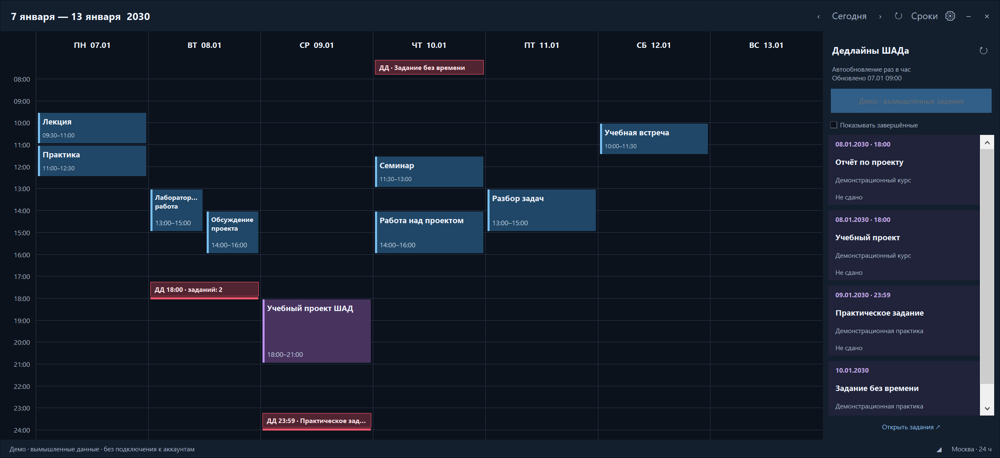

# Weekly Schedule Widget

Недельный календарь для Windows 10/11: события Google Календаря и дедлайны ШАДа в одном окне. Python + Tk, тёмный фон, обычное окно или закрепление на рабочем столе.



На скриншоте — **вымышленные данные**. В репозитории нет преднастроенного аккаунта, личных ссылок, расписания, заданий или браузерной сессии.

## Возможности

- Семь дней, навигация по неделям, текущий момент, повторяющиеся события и пересечения.
- Google Calendar через собственную секретную iCal-ссылку; кэш для работы без сети.
- Дедлайны ШАДа в боковой панели и красными полосами в день и время сдачи.
- Объединение совпадающих сроков, ссылки на задания, скрытие выполненных.
- Фоновая синхронизация дедлайнов раз в час и при входе в Windows, даже с закрытым окном.
- Режим рабочего стола под приложениями, ручное изменение размера и сохранение положения.

Время отображается **по Москве**. Google Tasks и запись событий обратно в Google Календарь не поддерживаются.

## Установка

Нужны обычный CPython **3.11+ с Tk и pip** и Windows 10/11. Для ШАДа также нужен установленный Microsoft Edge. Сборки Python из MSYS без Tk/pip не подходят.

```powershell
git clone https://github.com/evgrart/weekly-schedule-widget.git
cd weekly-schedule-widget
powershell -NoProfile -ExecutionPolicy Bypass -File scripts/setup_windows.ps1
```

Скрипт создаёт `.venv`, устанавливает зависимости и добавляет ярлык **Weekly Schedule (Public)** на рабочий стол и в меню «Пуск». Параметр `-ExecutionPolicy Bypass` действует только для данного процесса; глобальная политика Windows не меняется. Фоновое задание и автозапуск окна автоматически не включаются.

Если `python` в PATH указывает не на нужную версию, передай путь явно:

```powershell
powershell -NoProfile -ExecutionPolicy Bypass -File scripts/setup_windows.ps1 -Python 'C:\Path\To\Python\python.exe'
```

Можно запустить без ярлыка:

```powershell
.\.venv\Scripts\pythonw.exe widget.py
```

## Google Календарь

Открой ⚙ в виджете. Вставь **свою** ссылку из Google Календаря: «Настройки → нужный календарь → Интеграция календаря → Секретный адрес в формате iCal». Затем нажми «Сохранить».

Ссылка по умолчанию пустая. Она хранится только в локальном `config.json`, скрыта в поле настроек и не должна попадать в Git. Google может обновлять iCal-ленту с задержкой; ручное обновление виджета не ускоряет обновление на стороне Google.

## ШАД и фоновая синхронизация

1. Нажми **«Войти в ШАД»** в боковой панели.
2. Авторизуйся непосредственно в открывшемся окне Яндекса. Пароль и коды в виджет не передаются.
3. После загрузки заданий окно входа закроется. Выполненные задания скрыты флажком, архив не включается.
4. При необходимости включи фоновую задачу:

```powershell
powershell -NoProfile -ExecutionPolicy Bypass -File scripts/enable_deadline_sync.ps1
```

Задача `WeeklyScheduleWidgetHourlySync` запускается раз в час и через 30 секунд после входа в Windows. Она работает на батарее, не будит ноутбук и проверяет пропущенный запуск при следующей возможности. При выключенном или спящем компьютере синхронизация невозможна. Если сессия Яндекса истекла, снова войди через кнопку виджета.

Отключить фоновое задание:

```powershell
powershell -NoProfile -ExecutionPolicy Bypass -File scripts/disable_deadline_sync.ps1
```

Открытый виджет также проверяет сроки раз в час; ↻ проверяет сразу. При сетевой ошибке остаётся последняя успешная копия. Парсер читает текущую структуру сайта ШАДа; изменение страницы может потребовать обновления программы.

## Управление

- `‹`, `Сегодня`, `›` — выбор недели; стрелки клавиатуры тоже работают.
- `Сроки` — показать или скрыть боковую панель. Красные отметки в сетке остаются.
- Наведение — подробности; нажатие на дедлайн — открыть задание. Если сроков несколько, появится список.
- Перетаскивание за шапку — перемещение; `◢` — изменение размера.
- ⚙ — источник календаря, частота проверки, режим окна и автозапуск.
- `−` — свернуть; `×` — закрыть окно. Фоновая задача работает независимо от окна.

## Где хранятся личные данные

`%LOCALAPPDATA%\WeeklyScheduleWidgetPublic` — настройки, календарный кэш, дедлайны и отдельный браузерный профиль. Папка исходников для этого не используется. Для отдельного окружения можно задать `WEEKLY_SCHEDULE_DATA_DIR`.

**Не публикуй папку данных и настоящие скриншоты с личной информацией.** Подробнее: [privacy](docs/PRIVACY.md), [architecture](docs/ARCHITECTURE.md).

## Демо и тесты

Офлайн-демо использует только примеры из `examples/` и временную папку данных:

```powershell
.\.venv\Scripts\python.exe demo.py
.\.venv\Scripts\python.exe demo.py --screenshot docs/images/demo.png
.\.venv\Scripts\python.exe -m unittest discover -s tests -v
.\.venv\Scripts\python.exe tools/check_secrets.py
.\.venv\Scripts\python.exe tools/check_secrets.py --history
```

Тесты не используют личный кабинет и настоящий календарь. GitHub Actions запускает их на Windows с Python 3.12 и 3.14 и проверяет историю на случайное включение приватных данных.

Лицензия: [MIT](LICENSE).
