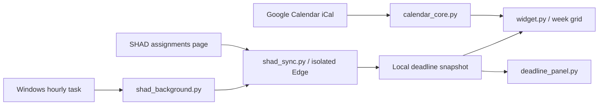

# Architecture

The application targets Windows 10/11 and uses Python and Tk. Times are displayed in `Europe/Moscow`.

`app_paths.py` keeps private runtime state outside the source checkout. An optional
`WEEKLY_SCHEDULE_DATA_DIR` overrides the per-user data directory for tests or a
separate installation. The public edition uses separate data, mutex, startup and
scheduled-task names from earlier personal installations.

`calendar_core.py` expands recurring iCalendar events and assigns overlap lanes.
`desktop_anchor.py` optionally attaches the widget to Explorer's desktop host.
The normal window is the default. Desktop embedding depends on the Windows shell
and is not a portable API.

`deadline_core.py` parses the observed SHAD open-assignment table, validates dates,
groups equal deadlines, and atomically replaces the local snapshot. Completed and
undated assignments are omitted from the time grid. Date-only deadlines use a
header banner; timed deadlines extend the visible hours when necessary.

`shad_sync.py` is read-only. The user signs in directly in a separate Edge window;
later checks use that same isolated local profile in headless mode. There is no
password field in the widget and no code to submit assignments. A page-layout
change causes an explicit error and preserves the last good snapshot.

`shad_background.py` bounds the scheduled worker's lifetime and owns its child
process job. Closing that job cleans up only its own helper and browser processes.
Task Scheduler runs hourly and at sign-in, allows battery operation, retries
failures, and catches up on missed runs without waking the laptop.

Google Calendar and SHAD synchronization are independent. This project does not
write Google Calendar events or integrate Google Tasks. Google may delay changes
in its iCal feed. The SHAD page is not a documented public API and its parser may
need maintenance if the site's layout changes.
